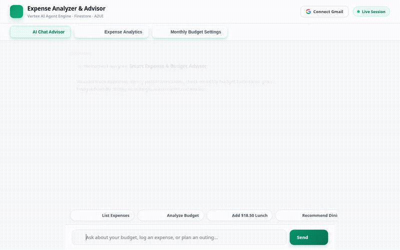

# 💰 Expense Analyzer & Financial Advisor

An autonomous AI financial advisor and expense tracking system built with the **Agent Development Kit (ADK)** and **Gemini 3.8 Flash**, deployed to **Vertex AI Agent Engine** (Reasoning Engine) and served with an agent-first web interface on **Cloud Run**.

---

<div align="center">



*Screen recording of the agent analyzing expenses, reporting burn rate, and suggesting dining options via Google Maps.*

</div>

---

## 🎯 What the Agent Does

Based on the implementation in [`expense-analyzer/app/agent.py`](expense-analyzer/app/agent.py), the agent provides autonomous financial reasoning and execution tools:

* **Firestore Transaction Tracking (`add_expense`, `list_expenses`)**: Records, categorizes, and retrieves transaction entries directly from **Google Cloud Firestore**.
* **Batch Import & Notification Parsing (`batch_import_transactions`, `parse_payment_notification`)**: Ingests raw multiline transaction dumps, CSV lines, and email payment alert snippets.
* **Live Gmail Bill & Statement Ingestion (`fetch_gmail_bills_and_expenses`)**: Queries user statements, utility bills, and charge notifications via the **Gmail API** with OAuth token validation.
* **Budget Burn Rate & Goals (`set_budget_and_goals`, `analyze_budget`)**: Computes category distributions, tracks overall burn rate against user limits, and alerts on overspending.
* **GCS CSV Financial Reports (`export_expenses_to_gcs`)**: Exports structured spending ledgers to **Google Cloud Storage** as formatted CSV files.
* **Google Maps Local Dining Discovery (`search_local_places`, `recommend_dining`, `geocode_address`, `search_nearby_places`)**: Finds real, budget-friendly local restaurants matching dietary preferences and monetary limits.
* **Cross-Session Long-Term Memory (`PreloadMemoryTool`, `after_agent_callback`)**: Automatically extracts and persists durable financial habits, user preferences, and budget goals to **Vertex AI Memory Bank**.
* **Agent-to-User Interface Cards (`A2UI`)**: Formats complex summaries and recommendations as rich A2UI cards instead of plain markdown text.
* **Multi-Currency Conversion (`convert_currency`)**: Calculates live or travel expense adjustments across global currencies.

---

## ☁️ Google Cloud Services & Frameworks Used

| Service / Tool | Role in this Project | Code Location |
| :--- | :--- | :--- |
| **Gemini 3.8 Flash** | Core LLM reasoning model for multi-turn planning & tool dispatch | `app/agent.py` |
| **Agent Development Kit (ADK)** | Python framework for agents, tools, memory tools, and lifecycle callbacks | `app/agent.py` |
| **Vertex AI Agent Engine** | Serverless reasoning engine running the containerized ADK agent | `agents-cli-manifest.yaml` |
| **Vertex AI Memory Bank** | Long-term memory store (`PreloadMemoryTool` + `generate_memories_callback`) | `app/agent.py` |
| **Google Cloud Firestore** | NoSQL transactional store for expense records and categories | `app/agent.py`, `frontend/main.py` |
| **Google Cloud Storage (GCS)** | Object storage bucket for exported CSV reports | `app/agent.py` |
| **Google Maps Places & Geocoding** | Discovery of real dining and outing locations | `app/agent.py` |
| **Gmail API (OAuth 2.0)** | Scanning bills, receipts, and statement alerts | `app/agent.py`, `frontend/main.py` |
| **A2UI (Agent-to-User Interface)** | Native card rendering engine for agent responses | `app/a2ui_utils.py` |
| **Google Cloud Run** | Hosts the FastAPI proxy and interactive web interface | `frontend/Dockerfile` |

> **Note on planned features**:
> Domain image generation via `gemini-3.1-flash-lite-image` is part of the project brief but is **planned, not yet implemented** in the active agent toolset.

---

## 📂 Project Layout

```text
.
├── expense-analyzer/              # Agent Backend (ADK / Reasoning Engine)
│   ├── app/
│   │   ├── __init__.py
│   │   ├── a2ui_utils.py          # A2UI response callbacks and schema validation
│   │   └── agent.py               # Gemini 3.8 agent, function tools, memory callbacks
│   ├── requirements.txt           # Agent runtime dependencies
│   └── agents-cli-manifest.yaml   # Vertex AI deployment manifest
│
├── frontend/                      # Web Frontend & FastAPI Proxy
│   ├── static/
│   │   ├── index.html             # Chart.js analytics dashboard, chat UI, iOS budget editor
│   │   └── favicon.ico
│   ├── Dockerfile                 # Cloud Run container definition
│   ├── main.py                    # A2A client proxy, Firestore endpoints & OAuth handling
│   └── requirements.txt           # Frontend dependencies (FastAPI, a2a-sdk, Chart.js)
│
├── demo.gif                       # Inline recorded walkthrough of the agent
└── README.md                      # Project documentation
```

---

## 🛠️ Local Setup & Execution

### 1. Prerequisites
* Python 3.11+
* Google Cloud SDK (`gcloud` CLI) authenticated with access to Vertex AI, Firestore, and GCS:
  ```bash
  gcloud auth login
  gcloud auth application-default login
  ```

### 2. Configure Environment Variables
In the `frontend/` directory, create a `.env` file:
```bash
GCP_PROJECT="your-project-id"
GCP_REGION="us-central1"
AGENT_ENGINE_RESOURCE_NAME="projects/<project-number>/locations/us-central1/reasoningEngines/<id>"
AGENT_DIRECTORY="app"
```

### 3. Run the Frontend & Proxy Server Locally
```bash
cd frontend
python -m venv .venv
source .venv/bin/activate
pip install -r requirements.txt
uvicorn main:app --host 0.0.0.0 --port 8080
```
Then navigate in your local web browser to the port configured above.

---

## 🚀 Deployment

### Deploy Backend Agent to Vertex AI
From the `expense-analyzer/` folder:
```bash
agents-cli deploy
```

### Deploy Frontend Web Proxy to Cloud Run
From the root directory:
```bash
gcloud run deploy expense-analyzer-frontend \
  --source ./frontend \
  --region us-central1 \
  --allow-unauthenticated
```

---

## 📄 License
This project is open-source under the [Apache 2.0 License](LICENSE).
